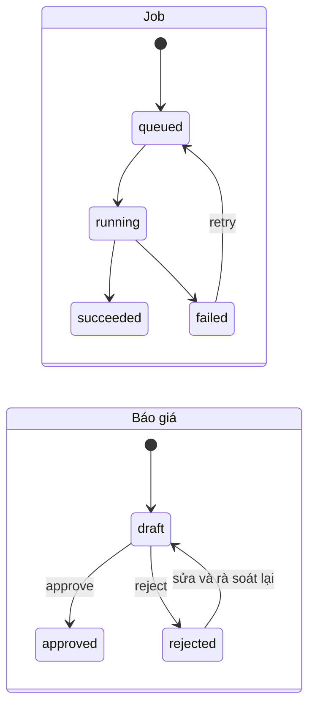

# Kế hoạch dự án CAD2BOM

Trạng thái: bản nháp. Cập nhật 02/11/2026. Đã có khung backend (FastAPI), bản demo UI (Streamlit) chạy ở chế độ mô phỏng, và test cơ bản. **Chưa có xử lý bản vẽ thật nào chạy được.** Mọi dữ liệu trong demo là dữ liệu minh họa.

Mục lục: 1 Mục tiêu · 2 Nguyên tắc · 3 Pipeline · 4 JSON chuẩn · 5 Hợp đồng API · 6 Phân công · 7 Các giai đoạn · 8 Câu hỏi mở · 9 Rủi ro · 10 Việc còn treo

## 1. Mục tiêu và phạm vi

CAD2BOM đọc bản vẽ CAD hoặc ảnh, ra dữ liệu có cấu trúc, tạo BOM và báo giá nháp. Người duyệt xong mới xuất Excel hoặc nhập ERP.

| | Nội dung |
| --- | --- |
| Làm | Nhánh CAD (DXF; DWG khi có giấy phép converter), nhánh ảnh, JSON chuẩn, BOM và báo giá nháp, xuất Excel/CSV, web demo 5 bước, đo lường PoC |
| Chưa làm | Nhập ERP thật, triển khai trong môi trường khách, giao diện production |

Các KPI (giảm 40–50% công dự toán trong proposal, 15–25% trong thiết kế E2E, bóc khối lượng còn vài phút) là **giả thuyết**, chưa thống nhất với đối tác. Chỉ coi là kết quả sau khi đo trong PoC.

## 2. Nguyên tắc ràng buộc

Đã chốt trong `CLAUDE.md`, không đổi khi chưa được đồng ý:

1. Hai nhánh theo dạng file đầu vào; có cả hai thì ưu tiên nhánh CAD.
2. Nhánh CAD do code xử lý, không dùng LLM.
3. Nhánh ảnh dùng AI model (detect, segment, OCR); kết quả là ước lượng.
4. Số lượng, chiều dài, diện tích do code đếm và đo, model không tự đếm.
5. Một JSON chuẩn dùng chung cho cả hai nhánh.
6. Mỗi giá trị truy ngược được về bản vẽ (`handle`, `bbox`).
7. Con người ở hai chỗ: duyệt mục confidence thấp, phê duyệt báo giá cuối; ERP chỉ nhập sau khi duyệt.
8. Bản vẽ không ra ngoài môi trường của khách.

## 3. Pipeline

### 3.1 Luồng tổng thể

```mermaid
flowchart LR
    U["Người lập dự toán<br/>tải bản vẽ"] -->|"POST /drawings/cad<br/>hoặc /drawings/image"| UP["Lưu bản gốc<br/>tạo job"]
    UP --> BR{"Dạng file"}

    BR -->|"DWG, DXF, PDF vector"| C1["Đọc file"] --> C2["Kiểm kê<br/>layer, block, text"] --> C3["Dựng đối tượng<br/>tường, phòng"] --> C4["Phân loại<br/>theo mapping"] --> C5["Đếm, đo<br/>bằng code"]
    C4 -.->|"layer, block lạ"| MP["Người duyệt mapping<br/>lưu kho cấu hình"]
    MP -.-> C4

    BR -->|"PNG, JPG, PDF scan"| I1["Tiền xử lý<br/>xoay, khử nhiễu, tile"] --> I2["Detect, segment<br/>AI model"] --> I3["OCR<br/>AI model"] --> I4["Hiệu chỉnh tỷ lệ<br/>pixel sang mét"] --> I5["Đếm, đo<br/>bằng code"]

    C5 --> J[("JSON chuẩn")]
    I5 --> J
    J --> RV["Rà soát<br/>mục confidence thấp"] --> BM["Gom BOM<br/>nhóm class + spec"] --> PR["Áp quy tắc<br/>và định giá"] --> QT["Báo giá nháp"] --> AP{"Phê duyệt<br/>người duyệt khác người lập"}
    AP -->|"duyệt"| EX["Xuất Excel, CSV<br/>nhập ERP (chưa làm)"]
    AP -->|"từ chối"| RV
```



Phần xử lý theo bản vẽ (từ đọc file đến JSON chuẩn) chạy nền trong một job. Phần từ rà soát trở đi là thao tác của người dùng trên dữ liệu đã có.

### 3.2 Các bước và dữ liệu vào ra

| Bước | Vào | Ra | Ai làm | Giai đoạn |
| --- | --- | --- | --- | --- |
| Lưu bản gốc, tạo job | file tải lên | `drawing_id`, `job_id` | code | GĐ1 |
| Đọc file (CAD) | DXF/DWG/PDF vector | cấu trúc entity | code (`ezdxf`) | GĐ2 |
| Kiểm kê (CAD) | entity | danh sách layer, block, text, số entity | code | GĐ2 |
| Dựng đối tượng (CAD) | entity rời | tường, phòng | code | GĐ2 |
| Phân loại (CAD) | đối tượng + mapping | `class`, `spec` | code; layer/block lạ do người duyệt | GĐ2 |
| Tiền xử lý (ảnh) | PNG/JPG/PDF scan | ảnh đã xoay, khử nhiễu, cắt tile | code | GĐ2 |
| Detect, segment (ảnh) | tile | vùng, ký hiệu, `confidence` | AI model | GĐ2 |
| OCR (ảnh) | tile | text kích thước, ghi chú | AI model | GĐ2 |
| Hiệu chỉnh tỷ lệ (ảnh) | kích thước đọc được | hệ số pixel sang mét | code | GĐ2 |
| Đếm, đo | phần tử đã phân loại | `qty`, `length_m`, `area_m2` | code, không phải model | GĐ2 |
| Rà soát | JSON chuẩn | JSON đã duyệt/sửa | người | GĐ1 (UI), GĐ4 (dữ liệu thật) |
| Gom BOM, quy tắc, định giá | JSON đã duyệt, quy tắc, bảng giá | BOM, báo giá nháp | code | GĐ3 |
| Phê duyệt, xuất | báo giá nháp | báo giá đã duyệt, file CSV/Excel | người duyệt, code | GĐ3 |

### 3.3 Vòng đời job và báo giá



Job `succeeded` thì mới có JSON chuẩn để rà soát và dựng BOM. Báo giá luôn bắt đầu ở `draft`; chỉ `approved` mới xuất được file và (sau này) nhập ERP.

## 4. JSON chuẩn (hợp đồng dữ liệu)

Một phần tử:

```json
{
  "id": "D-01",
  "class": "door",
  "spec": "W800",
  "qty": 1,
  "source": "cad",
  "view": "plan_1F",
  "handle": "2F3A",
  "bbox": [412, 208, 452, 248],
  "confidence": 0.97
}
```

| Trường | Kiểu | Quy tắc |
| --- | --- | --- |
| `id` | string | Ổn định giữa các lần chạy và giữa các view, dùng để loại trùng và để diff phiên bản |
| `class` | string | Loại phần tử (ví dụ `door`, `window`, `wall`, `equipment`). Danh sách đầy đủ chưa chốt, phụ thuộc loại công trình ưu tiên |
| `spec` | string | Quy cách, ví dụ `W800` |
| `qty` / `length_m` / `area_m2` | number | **Đúng một** trong ba, tùy phần tử đếm, đo dài hay đo diện tích |
| `source` | `"cad"` hoặc `"image"` | Nhánh sinh ra phần tử |
| `view` | string | View chứa phần tử, ví dụ `plan_1F` |
| `handle` | string hoặc null | Mã entity trong file CAD. Nhánh ảnh để `null` |
| `bbox` | `[x0, y0, x1, y1]` | Nhánh CAD: tọa độ bản vẽ. Nhánh ảnh: tọa độ pixel |
| `confidence` | number 0–1 | Nhánh CAD do code gán; nhánh ảnh lấy từ model, cần hiệu chỉnh (đo ở GĐ5) |

Trạng thái rà soát (`reviewed`, người sửa, thời điểm) lưu ở bảng `element` và `audit_log`, không nằm trong JSON chuẩn.

Lưu ý: UI demo hiện dùng `value` và `unit` thay cho `qty`/`length_m`/`area_m2`. Khi nối API thật thì UI đổi sang đúng các trường trên.

## 5. Hợp đồng API (bản tối giản cho PoC)

Tiền tố `/api/v1`, JSON, riêng upload dùng `multipart/form-data`. Đây là **thiết kế đề xuất**, chưa route nào tồn tại ngoài `/health`. API được thiết kế theo UI một màn hình: tải bản vẽ → xem tiến độ → xem BOM → chọn dòng để xem phần tử và bbox.

### 5.1 Route cần làm

| # | Method | Path | Việc |
| --- | --- | --- | --- |
| 1 | POST | `/drawings/cad` | Tải DWG, DXF, PDF vector. Form: `files[]`. Trả `202 {drawing_id, job_id}` |
| 2 | POST | `/drawings/image` | Tải PNG, JPG, PDF scan. Như trên |
| 3 | GET | `/jobs/{job_id}/events` | Stream tiến độ (SSE) |
| 4 | GET | `/drawings/{drawing_id}/elements` | Phần tử theo JSON chuẩn (mục 4), có `bbox`, `handle`, `confidence` |
| 5 | GET | `/drawings/{drawing_id}/quote` | Các dòng BOM kèm giá, tự dựng lại từ phần tử hiện tại |

Cộng `GET /health` (đã có, nằm ngoài `/api/v1`). Chưa cần đăng nhập ở PoC.

UI chọn route 1 hay 2 theo loại file (`ui/file_kind.py`); backend kiểm tra nội dung có khớp nhánh không. Route 4 và 5 chỉ trả dữ liệu khi job đã `succeeded`.

### 5.2 Hợp đồng chi tiết

**Tải bản vẽ**

```
POST /api/v1/drawings/image      files[]=tang1.png
202 { "drawing_id": "DRW-001", "job_id": "JOB-001" }
```

**Stream tiến độ.** Mỗi sự kiện là một dòng `data:` chứa JSON; stream đóng sau sự kiện `succeeded` hoặc `failed`. Tên bước theo nhánh (mục 3.2):

```
GET /api/v1/jobs/JOB-001/events      Accept: text/event-stream

data: {"status": "running",   "progress": 0.33, "step": "Detect, segment", "error": null}
data: {"status": "running",   "progress": 0.67, "step": "OCR",             "error": null}
data: {"status": "succeeded", "progress": 1.0,  "step": "Đếm, đo",         "error": null}
```

`status` ∈ `running`, `succeeded`, `failed`; `progress` từ 0 đến 1.

**Phần tử** (dùng để vẽ bbox và hiện thông tin khi chọn dòng BOM):

```
GET /api/v1/drawings/DRW-001/elements
200 { "items": [
      { "id": "WD-03", "class": "window", "spec": "W1200", "qty": 2, "source": "image",
        "view": "plan_1F", "handle": null, "bbox": [120, 40, 200, 60], "confidence": 0.56 } ] }
```

`bbox` là `[x0, y0, x1, y1]`: **pixel của ảnh đã tải lên** với nhánh ảnh, tọa độ bản vẽ với nhánh CAD. Mỗi phần tử có đúng một trong `qty`, `length_m`, `area_m2`.

**Báo giá / BOM.** Mỗi dòng gom nhiều phần tử, liên kết ngược qua `source_ids` (là `id` ở route 4):

```
GET /api/v1/drawings/DRW-001/quote
200 { "lines": [
      { "class": "door", "spec": "W800", "qty": 1, "unit": "bộ",
        "unit_price": 3200000, "amount": 3200000, "source_ids": ["D-01"] },
      { "class": "equipment", "spec": "EQ-07", "qty": 1, "unit": "bộ",
        "unit_price": null, "amount": null, "source_ids": ["EQ-07"] } ],
      "total_priced": 3200000 }
```

`unit_price = null` nghĩa là chưa có giá: không tính vào `total_priced`, UI cảnh báo. (Số liệu chỉ để minh họa định dạng.)

### 5.3 Lỗi

Trả `{ "error": { "code": "...", "message": "..." } }`:

| HTTP | `code` | Khi nào |
| --- | --- | --- |
| 404 | `NOT_FOUND` | Không có `drawing_id` hoặc `job_id` |
| 409 | `JOB_NOT_FINISHED` | Gọi route 4 hoặc 5 khi job chưa `succeeded` |
| 415 | `UNSUPPORTED_FILE_TYPE` | Định dạng chưa hỗ trợ |
| 422 | `FILE_BRANCH_MISMATCH` | Nội dung file không khớp nhánh đã gọi (ví dụ ảnh gửi vào `/drawings/cad`) |

### 5.4 Để dành (chưa làm)

Cần khi thêm bước rà soát và phê duyệt vào UI. Thiết kế giữ sẵn để UI không phải đổi hợp đồng:

| Method | Path | Việc |
| --- | --- | --- |
| PATCH | `/elements/{element_id}` | Duyệt hoặc sửa `spec`, `qty` / `length_m` / `area_m2`, `reviewed` |
| POST | `/quotes/{quote_id}/approve` | Phê duyệt, vai trò `approver` |
| GET | `/quotes/{quote_id}/export?format=csv` | Xuất CSV, chỉ khi đã duyệt |

Khi làm: gửi header `X-User` để biết người dùng và vai trò. `approve` chỉ thành công khi người gọi là `approver`, khác người tải bản vẽ, không còn phần tử confidence thấp chưa duyệt, và báo giá đang `draft`. Lỗi kèm theo: `403 FORBIDDEN_ROLE`, `403 SELF_APPROVAL`, `409 REVIEW_PENDING`, `409 INVALID_STATE`. Dòng chưa có giá chỉ cảnh báo, không chặn duyệt (**chờ nhóm chốt**).

Không làm trong PoC: project, version và diff bản vẽ, đăng nhập thật, API cấu hình (mapping, quy tắc, bảng giá sửa bằng file trong `data/customers/<khách>/`), API đọc nhật ký (bảng `audit_log` vẫn ghi), nhập ERP.

## 6. Phân công và phụ thuộc

Nhóm 2 người, gọi tạm là **A** và **B**. Phân công chỉ là đề xuất, nhóm tự chốt.

| Giai đoạn | Ai | Phụ thuộc |
| --- | --- | --- |
| GĐ0 Nền tảng | A + B | không |
| GĐ1 Web demo trên dữ liệu mẫu | A: backend, B: UI | GĐ0 |
| GĐ2 Hai nhánh xử lý | A: nhánh CAD, B: nhánh ảnh (song song) | GĐ0 |
| GĐ3 BOM và báo giá | A + B, chia khi tới | GĐ2 |
| GĐ4 Nối pipeline thật vào demo | A + B | GĐ1, GĐ2, GĐ3 |
| GĐ5 Đo lường PoC | A + B | GĐ4 và dữ liệu thật của khách |

Mặc định làm demo trước (GĐ1) rồi tới hai nhánh (GĐ2). Nếu cần có pipeline thật sớm hơn, GĐ1 và GĐ2 có thể đổi thứ tự hoặc xen kẽ.

### Vị trí code (đề xuất, chờ chốt)

Thư mục `pipeline/` đã bị bỏ để backend gọn. Logic xử lý bản vẽ cần một chỗ; đề xuất đặt thành gói con của `services/`, cùng cấp với các service nghiệp vụ:

```
backend/
├── api/v1/            # route (mục 5)
├── services/
│   ├── cad/           # nhánh CAD: reader, inventory, builder, classifier, measure
│   ├── image/         # nhánh ảnh: preprocess, detect, ocr, scale, measure
│   ├── bom/           # aggregate, rules, pricing, export
│   └── (drawing, analysis, review, quote, approval ...)  # service nghiệp vụ
├── repositories/  models/  schemas/  workers/  config/  core/  db/
```

Quy tắc: `services/cad/` không import thư viện model hay LLM, và `cad/`, `image/` không import lẫn nhau; hai nhánh chỉ gặp nhau ở JSON chuẩn (`schemas/`). Cấu hình theo khách đặt ở `data/customers/<khách>/` (mapping.yaml, rules.yaml, prices.csv) vì là dữ liệu khách, không commit.

## 7. Các giai đoạn

### GĐ0 – Nền tảng

Phần lớn đã xong: git, uv, FastAPI + Streamlit, khung thư mục, `pyproject.toml`, `.gitignore`, test `/health`, PyTorch (`torch 2.11.0+cu128`, GPU nhận).

Còn lại:
- Thêm `openpyxl` để xuất Excel.
- Quyết định vị trí code xử lý bản vẽ (mục 6).
- Viết model pydantic cho JSON chuẩn (mục 4) trong `backend/schemas/`.
- Viết test kiểm tra `backend/services/cad/` không import torch hay thư viện LLM.

Tiêu chí hoàn thành: `uv sync`, `uv run pytest`, `uv run ruff check .` đều qua.

### GĐ1 – Web demo trên dữ liệu mẫu

A phụ trách backend, B phụ trách UI.

**UI (đã làm, chạy mô phỏng):** một màn hình duy nhất (`ui/app.py`), hai cột.
- Trái: tải bản vẽ; tự xác định loại file và chọn nhánh (`ui/file_kind.py`); nếu là ảnh thì hiện ảnh. PDF chưa tự phân biệt được vector hay scan nên hỏi người dùng.
- Phải: nút "Hiển thị BOM" → gửi file, stream tiến độ từng bước (`GET /jobs/{id}/events`) → bảng BOM. Chọn một dòng thì bên dưới hiện thông tin từng phần tử nguồn (ID, handle, confidence, bbox), và nếu bản vẽ là ảnh thì khung bbox của dòng đó tô sáng trên ảnh bên trái. Dòng thiếu giá có cảnh báo.
- Streamlit không có sự kiện hover; "chọn" nghĩa là bấm vào dòng.
- Chế độ mô phỏng bật mặc định (`UI_MOCK=1`); bbox mẫu co giãn theo kích thước ảnh và ghi rõ là mô phỏng. 12 test qua.
- Chưa có trên UI: rà soát/sửa phần tử, phê duyệt, xuất CSV. Hai nguyên tắc "người duyệt ở hai chỗ" (mục 2) cần được thể hiện lại nếu demo dùng để trình bày với khách; chờ nhóm quyết định.

**Backend (chưa làm):**
- `models/`, `db/`: SQLite, alembic. Bảng: drawing, job, element, audit_log (BOM tính từ element khi gọi `/quote`, không cần bảng riêng).
- Luồng một chiều: `api/v1` → `services` → `repositories` → `models`.
- Cài 5 route ở mục 5.1, trả dữ liệu minh họa; `workers/` giả lập tiến độ bằng `BackgroundTasks`.
- `api/deps.py`: để trống ở PoC (chưa cần auth); thêm khi làm các route ở mục 5.4.

**Việc UI còn lại khi nối backend:** đặt `UI_MOCK=0`. Phần tử mẫu đã dùng đúng `qty`/`length_m`.

Tiêu chí hoàn thành: chạy trọn 5 bước trên dữ liệu mẫu qua API thật; người duyệt phải khác người lập (có test API); mỗi route chính có test.

### GĐ2 – Hai nhánh xử lý

Một giai đoạn, hai luồng song song. Hai luồng chỉ giao tiếp qua JSON chuẩn, không import lẫn nhau.

**Luồng A – Nhánh CAD** (code thuần, không LLM)
- `services/cad/`: `reader` (đọc DXF bằng `ezdxf`), `inventory`, `builder`, `classifier`, `measure`.
- DWG đi qua converter. Giấy phép ODA File Converter chưa chốt, nên giai đoạn này chỉ làm DXF.
- Layer hoặc block lạ: ghi vào log của job; người duyệt thêm mapping vào `data/customers/<khách>/mapping.yaml` rồi chạy lại. (API sửa mapping để sau PoC.)
- Tiêu chí: DXF tổng hợp cho số lượng, chiều dài, diện tích đúng; JSON ra có `handle` và `bbox`.

**Luồng B – Nhánh ảnh**
- `services/image/`: `preprocess`, `scale` (pixel sang mét), `measure` là code. `detect` và `ocr` đặt sau interface để thay model.
- So sánh ứng viên: YOLO, Mask R-CNN, kiểu CubiCasa5K cho detect và segment; PaddleOCR cho OCR. Tên model chưa chốt. Code thử nghiệm đặt ở `experiments/` (sẽ tạo khi cần).
- Dữ liệu huấn luyện: ảnh tự sinh từ CAD của khách (render rồi làm mờ, lệch, nhiễu; nhãn lấy từ entity) và ảnh scan thật có nhãn do người gán. Luồng A cung cấp ảnh render và nhãn cho luồng B.
- Tiêu chí: ra JSON chuẩn với `source=image`, `handle` để trống, `bbox` theo tọa độ ảnh, gắn cờ ước lượng.
- Trước khi đưa bất kỳ dataset hay công cụ nào vào, kiểm tra giấy phép. Annotation của FloorPlanCAD là CC BY-NC 4.0, chỉ dùng để thử nghiệm. Thông số model và dataset phải dẫn nguồn, không đoán.

### GĐ3 – BOM và báo giá

Biến JSON chuẩn đã rà soát thành BOM và báo giá nháp, rồi phê duyệt và xuất file. **Với UI một màn hình, phần bắt buộc là gom BOM, quy tắc, định giá (3.1–3.3), phục vụ route `/quote`. Phê duyệt và xuất file (3.4, 3.5) là phần để dành, đi cùng các route ở mục 5.4.** Code đặt ở `services/bom/` và các service `quote`, `approval`, `export`.

**3.1 Gom BOM (`aggregate`)**
- Nhóm theo cặp (`class`, `spec`). Cộng `qty`, `length_m` hoặc `area_m2` theo loại phần tử.
- Mỗi dòng BOM giữ danh sách `source_ids` (ID phần tử nguồn) để truy ngược về bản vẽ.
- Phần tử trùng `id` giữa các view chỉ tính một lần.
- Dựng lại mỗi lần gọi `GET /drawings/{id}/quote`, không lưu BOM riêng.

**3.2 Quy tắc bóc tách (`rules`)**
- Đọc từ `data/customers/<khách>/rules.yaml`. Định dạng chốt sau khi có mẫu thật từ khách (câu hỏi mở), không đoán trước.
- Không có quy tắc thì BOM giữ nguyên số đã gom, ghi rõ "chưa áp quy tắc".

**3.3 Định giá (`pricing`)**
- Bảng giá `prices.csv` với các cột `class, spec, unit, unit_price, currency`.
- Dòng không khớp bảng giá: `unit_price = null`, gắn cờ `no_price`, không tính vào tổng.
- Báo giá nêu rõ tổng chỉ gồm các dòng đã có giá và số dòng chưa có giá. Thuế và chiết khấu chưa tính, chờ khách xác nhận.

**3.4 Báo giá và phê duyệt**
- Trạng thái `draft` → `approved` hoặc `rejected` (sơ đồ ở mục 3.3 của tài liệu này).
- Điều kiện duyệt và mã lỗi ở mục 5.4 (để dành, chưa có trên UI một màn hình).
- Mỗi lần duyệt, từ chối, xuất file đều ghi audit log.

**3.5 Xuất file (`export`)**
- CSV và Excel (`openpyxl`), cột: Hạng mục, Quy cách, SL, ĐVT, Đơn giá, Thành tiền, ID nguồn. Chỉ xuất khi báo giá đã `approved`.
- Nhập ERP: chưa làm, route trả `501`.

**3.6 Diff giữa các phiên bản bản vẽ:** ngoài phạm vi PoC (không có version trong API). Giữ `id` phần tử ổn định để làm sau.

**Tiêu chí hoàn thành**
- Tổng số lượng từng dòng BOM bằng tổng các phần tử nguồn (test tự động trên fixtures minh họa).
- Dòng thiếu giá có cờ `no_price` và không vào tổng.
- Sửa một phần tử rồi dựng lại BOM thì BOM đổi đúng dòng đó.
- Không duyệt được khi còn phần tử gắn cờ chưa duyệt, hoặc người duyệt trùng người lập (test API trả `409` và `403`).
- Xuất CSV đúng cột, chỉ xuất khi đã duyệt.

### GĐ4 – Nối pipeline thật vào demo

- `workers/` gọi `services/cad` và `services/image` thật thay cho giả lập.
- `drawing_view` tô sáng phần tử theo `bbox` hoặc `handle`, hiện bằng ảnh `GET /drawings/{id}/preview`. Hạn chế: Streamlit không có canvas tương tác như React, nên chỉ đủ cho demo.
- Gắn cờ mục confidence thấp vào màn rà soát.

Tiêu chí hoàn thành: tải DXF thật → ra BOM → phê duyệt → xuất Excel.

### GĐ5 – Đo lường PoC

Code đặt ở `eval/` (sẽ tạo khi tới giai đoạn này).
- Chỉ số: tỷ lệ sót, tỷ lệ đếm trùng, độ hiệu chỉnh của confidence, thời gian xử lý, công rà soát của người.
- Đo sai số **theo từng dòng hạng mục**, không báo một con số % chung, vì sai số trái dấu dễ triệt tiêu nhau trên tổng tiền.
- Đo riêng từng nhánh và từng bước, không chỉ đo AI model.
- Đáp án chuẩn là bộ bóc tách của chuyên gia trên bản vẽ thật, đặt ở `data/ground_truth/`. Hiện chưa có.

## 8. Câu hỏi mở và giai đoạn bị chặn

| Câu hỏi cần khách xác nhận | Chặn |
| --- | --- |
| Khách có file DWG/DXF gốc hay chủ yếu PDF và ảnh? | Đọc DWG ở GĐ2; mức ưu tiên giữa luồng A và B |
| Loại công trình và hạng mục ưu tiên cho BOM đầu tiên? | Danh sách `class`, mapping ở GĐ2, quy tắc ở GĐ3 |
| Có bộ bóc tách chuẩn của chuyên gia không? | GĐ5 |
| Quy tắc bóc tách, master vật tư, ERP đích? | Định dạng `rules.yaml` và `prices.csv` ở GĐ3, nhập ERP |
| Báo giá có tính thuế, chiết khấu không? | Công thức tổng ở GĐ3 |
| Ai trả giấy phép đọc DWG (ODA File Converter) khi chạy thật? | Đọc DWG khi chạy thật |
| Con số KPI chính thức (40–50% hay 15–25%)? | Cách trình bày kết quả PoC với đối tác |

Câu hỏi nội bộ nhóm cần chốt:
- Vị trí code xử lý bản vẽ (mục 6).
- Có chặn duyệt khi còn dòng chưa có giá không (mục 5).
- Ngưỡng `confidence` gắn cờ. Demo đang dùng 0.7 làm tham số minh họa, cần cấu hình được và chốt theo kết quả đo ở GĐ5.

## 9. Rủi ro

| Rủi ro | Cách giảm |
| --- | --- |
| Giấy phép dataset hoặc công cụ không cho dùng thương mại | Kiểm tra trước khi đưa vào; ghi nguồn và giấy phép trong `data/README.md` |
| Thiếu bản vẽ thật và đáp án chuẩn của khách | Chốt sớm các câu hỏi mở; giai đoạn đầu dùng fixtures tổng hợp, ghi rõ "minh họa" |
| UI chọn sai nhánh (ví dụ PDF vector bị coi là scan) | Backend kiểm tra nội dung và trả `FILE_BRANCH_MISMATCH`; PDF hỏi người dùng xác nhận |
| Nhóm chỉ 2 người, GĐ1 chiếm cả hai trước khi tách luồng ở GĐ2 | Giữ GĐ1 ở mức demo, không làm sâu hơn nhu cầu |
| Streamlit tô sáng phần tử không mượt | Chấp nhận cho demo; chuyển frontend khác nếu cần sau PoC |
| Mạng chậm khi cài gói nặng | Đặt `UV_HTTP_TIMEOUT` lớn, chạy nền (đã gặp với PyTorch) |
| Báo sai số một % chung che mất lỗi từng dòng | Đo theo từng dòng hạng mục (GĐ5) |
| Hợp đồng API đổi sau khi UI đã làm | Chốt mục 5 trước khi viết route (chỉ 5 route nên đổi rẻ); UI chỉ gọi qua `ui/api_client.py` |

## 10. Việc còn treo

- Proposal trên Claude Docs còn ghi `api/routes` và `config/` ở gốc: cập nhật hoặc bỏ.
- Nhóm xác nhận hợp đồng API (mục 5) và vị trí code xử lý (mục 6) rồi mới cài route.
